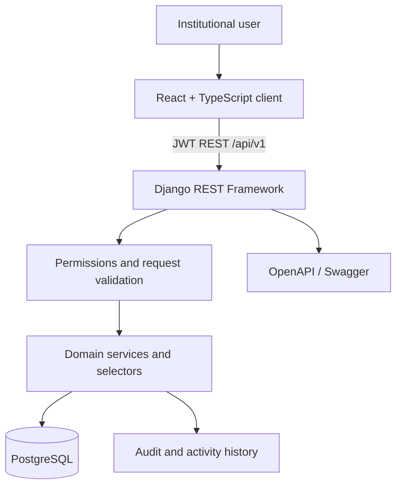
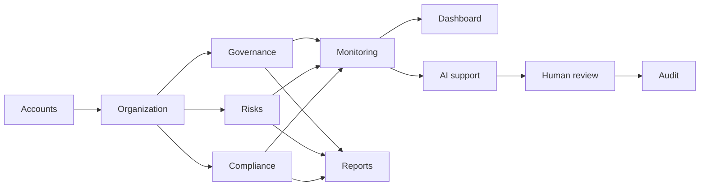
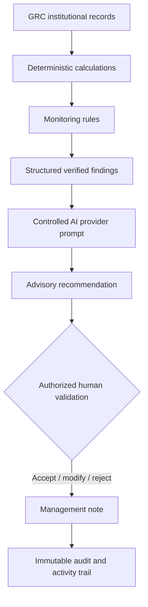

# GRACE Architecture

## System architecture

## Major modules

## AI decision-support flow

The AI provider receives a controlled snapshot rather than unrestricted database access. Stored user text is explicitly treated as untrusted data. Every response retains its input snapshot and provider metadata and displays the advisory notice. Only an authorized person can accept, modify, or reject it.

## Extension points

The provider protocol permits alternative AI services. The monitoring rule abstraction permits new deterministic controls. Scheduled execution can move from an operating-system scheduler to Celery Beat later without changing the rule layer. Attachments can move from local media storage to managed object storage without changing compliance records.

